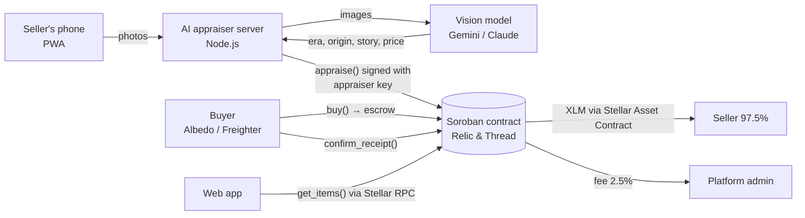

# Relic & Thread

**Snap a photo, get an AI appraisal, sell with on-chain escrow on Stellar.**
A marketplace for antiques and handmade pieces where the seller only takes photos, an AI appraiser agent dates the piece, tells its story and sets the price on-chain, and the buyer's payment waits in a Soroban escrow contract until the piece arrives.

| | |
|---|---|
| **Live app** | https://karmainaria.github.io/sansara/ (installable on iPhone/Android: Share → Add to Home Screen) |
| **Contract (Testnet)** | [`CBPXUJWJ4BYYSV35XYWEL2NCUFK7UCZPELWV43PZLHNXJNXAUBDQ445O`](https://stellar.expert/explorer/testnet/contract/CBPXUJWJ4BYYSV35XYWEL2NCUFK7UCZPELWV43PZLHNXJNXAUBDQ445O) |
| **Demo video** | _link added after recording_ |
| **Pitch deck** | https://claude.ai/artifact/HqeDWqSv3L2ZxmxtB5skH7 |
| **Event** | HackMeridian Lisbon 2026 · Builder track: Genesis · Thematic track: Stellar Composed |

---

## The problem

Antiques and handmade objects are one of a kind, so there is no brand to trust.

- **Buyers carry the risk.** They pay a stranger first and hope the piece is real and actually ships.
- **Sellers don't know what their piece is worth.** Most people who inherit a vase or a ring can't read a porcelain mark or a silver hallmark, so they underprice or overprice.
- **Makers lose margin.** Platform, card and currency fees stack on every sale, payouts take days, and selling across borders costs extra.

The antiques & collectibles market was about **$150B in 2025, with 67% of sales already online** (Global Market Insights); the global handicrafts market was about **$987B** (IMARC). The behaviour is there; the trust and pricing layer is missing.

## The solution

1. **Snap.** The seller uploads 1–4 photos: the whole piece, any marks or signature, the underside. Nothing else.
2. **AI appraisal.** An AI appraiser examines the photos for hallmarks, maker's marks, stamps, construction and style, cross-checks them with historical context (design movements, factories' active years, marking laws) and returns era, origin, maker, condition, a short history, a value range and a price. When evidence is thin it says so and lowers its confidence instead of inventing a maker.
3. **Price on-chain.** The appraiser is an agent with **its own Stellar key**. It writes title, description, category, price and the full appraisal report into the contract. The contract accepts prices **only** from that key: sellers can't inflate them, but they can always withdraw the piece.
4. **Escrow.** The buyer pays in XLM (USDC-ready). Funds are locked in the contract.
5. **Confirm.** The buyer confirms receipt; the contract pays the seller instantly minus a 2.5% platform fee. Refunds and admin-resolved disputes are built in.

### Target users

- **Makers** (jewelry, ceramics, textiles) who sell via Instagram and craft markets and want global buyers without the fee stack.
- **Dealers and people clearing an estate** who need buyers to trust a stranger's description, and need help pricing.
- **Collectors** who hold crypto and want to spend it on something real, safely, across borders.

### Value proposition

| | Classic marketplace | Relic & Thread |
|---|---|---|
| Pricing | Seller guesses | AI appraisal, recorded on-chain |
| Buyer protection | Platform policy | Smart-contract escrow |
| Seller payout | Days | Seconds after confirmation |
| Fees | Platform + card + FX | 2.5% on completed sales only |
| Cross-border | Extra cost and delay | Same as a local sale |
| Disputes | Opaque | Recorded on-chain |

---

## Architecture: how Stellar is used



| Component | What it does | Stellar piece |
|---|---|---|
| `contracts/marketplace` | Listings, AI-only pricing, escrow, refunds, disputes, fee split. Rust, 9 unit tests. | **Soroban smart contract** |
| AI appraiser agent | Signs `appraise()` with its own key; the contract rejects prices from anyone else. | **Agent wallet** (Stellar CLI key) |
| Payments | `token::Client::transfer` on native XLM; switch to USDC by deploying with the USDC SAC address. | **Stellar Asset Contract** |
| Wallets | Albedo (works in any mobile browser, no install) and Freighter (desktop extension). Users sign every action; we never hold user keys. | **Albedo, Freighter** |
| Web app | Reads listings and submits transactions directly over Stellar RPC; installable PWA. | **Stellar RPC, stellar-sdk** |
| Test funds | "Get test XLM" button for new wallets. | **Friendbot** |

### On-chain addresses (Testnet)

| Role | Address |
|---|---|
| Marketplace contract | [`CBPXUJWJ4BYYSV35XYWEL2NCUFK7UCZPELWV43PZLHNXJNXAUBDQ445O`](https://stellar.expert/explorer/testnet/contract/CBPXUJWJ4BYYSV35XYWEL2NCUFK7UCZPELWV43PZLHNXJNXAUBDQ445O) |
| AI appraiser agent | [`GAZMVV5DXJQ2HGY35DTJ3B4XSJOC2DB55GXBC2GJG6NDYXDOLQSQ5IDM`](https://stellar.expert/explorer/testnet/account/GAZMVV5DXJQ2HGY35DTJ3B4XSJOC2DB55GXBC2GJG6NDYXDOLQSQ5IDM) |
| Platform admin (fee receiver) | [`GA3V22ML4UV6EP4LWAPXWABOHAJDAPE5RXORZY6DPAVM5HE2M5FWT5SZ`](https://stellar.expert/explorer/testnet/account/GA3V22ML4UV6EP4LWAPXWABOHAJDAPE5RXORZY6DPAVM5HE2M5FWT5SZ) |
| Payment token | Native XLM via its Stellar Asset Contract `CDLZFC3SYJYDZT7K67VZ75HPJVIEUVNIXF47ZG2FB2RMQQVU2HHGCYSC` |
| RPC | `https://soroban-testnet.stellar.org` |

### Evidence of on-chain transactions

All calls are visible on the contract page on Stellar Expert: `submit_item` (seller), `appraise` (AI agent, with the full report), `buy` (escrow), `confirm_receipt` (payout + fee). Example: item **#14**, a blue-and-white porcelain vase photographed at the entrance of the HackMeridian venue in Lisbon, appraised by the AI at ≈ €65 (430.08 XLM), bought from an iPhone with Albedo and completed.

### Contract API

| Function | Caller | Effect |
|---|---|---|
| `submit_item(seller, image_url)` | seller | New item in `Pending`, photos only, no price |
| `appraise(id, title, description, category, price, report)` | **AI appraiser key only** | Sets identity, story and price → `Listed` |
| `cancel_listing(seller, id)` | seller | Withdraw a pending or listed item |
| `buy(buyer, id)` | buyer | Moves the price into escrow → `Paid` |
| `confirm_receipt(buyer, id)` | buyer | Pays seller (minus fee) and admin → `Completed` |
| `refund(seller, id)` | seller | Returns escrow to buyer → `Refunded` |
| `open_dispute(caller, id)` | buyer or seller | Freezes the deal → `Disputed` |
| `resolve_dispute(id, refund_buyer)` | admin | Refund buyer or pay seller |
| `set_fee`, `set_admin`, `set_appraiser` | admin | Configuration |
| `get_items(start, limit)`, `get_item(id)`, `item_count()` | anyone | Reads |

Status codes: `0 Listed · 1 Paid · 2 Disputed · 3 Completed · 4 Refunded · 5 Cancelled · 6 Pending`.

---

## Repository layout

```
contracts/marketplace/src/lib.rs   Soroban contract
contracts/marketplace/src/test.rs  unit tests
server/server.mjs                  AI appraiser agent (HTTP API + Stellar CLI signer)
server/start.sh                    starts the appraiser and makes its port public (Codespaces)
web/                               web app source (PWA: index.html, manifest, service worker, icons)
docs/                              copy of web/ served by GitHub Pages, plus uploaded listing photos
deploy.sh                          build, test and deploy the contract to testnet
setup.sh, step2–4.sh               the scripts used to build this during the hackathon (kept for transparency)
```

## Setup

Requirements: Rust with `wasm32v1-none` target, [Stellar CLI](https://developers.stellar.org/docs/tools/cli), Node 18+.
Everything below also works in a GitHub Codespace, which is how this project was built (from an iPad).

```bash
# 1. tools
rustup target add wasm32v1-none
curl -fsSL https://github.com/stellar/stellar-cli/raw/main/install.sh | sh

# 2. test and deploy the contract (creates funded testnet keys: bazaar-admin, appraiser)
cargo test
./deploy.sh            # prints CONTRACT_ID

# 3. AI appraiser
cp server/.env.example server/.env   # then fill in CONTRACT_ID and an AI key
stellar keys generate seller --network testnet --fund   # demo seller for wallet-less listings
bash server/start.sh                                    # or: node server/server.mjs

# 4. web app
#   in web/index.html → CONFIG set CONTRACT_ID and APPRAISER_URL (public URL of port 8787)
cp web/* docs/ && cd docs && python3 -m http.server 8080
```

### Environment variables (`server/.env`, never committed)

| Variable | Required | Meaning |
|---|---|---|
| `CONTRACT_ID` | yes | Marketplace contract address |
| `GEMINI_API_KEY` | one of these | Google AI Studio key (free tier works) |
| `ANTHROPIC_API_KEY` | one of these | Claude API key (used first if both are set) |
| `GEMINI_MODEL` | no | Preferred model, default `gemini-2.5-flash`; the server falls back to other Gemini models when one is overloaded |
| `ANTHROPIC_MODEL` | no | Claude model id |
| `STELLAR_NETWORK` | no | `testnet` (default) |
| `PAGES_BASE` | no | Public base URL where listing photos are served, default `https://karmainaria.github.io/sansara` |
| `XLM_EUR` | no | Fallback EUR/XLM rate if CoinGecko is unreachable |
| `PORT` | no | Default `8787` |

The appraiser signs with the Stellar CLI identity named `appraiser`; the demo seller identity is `seller`.

### Web app config (`web/index.html` → `CONFIG`)

`CONTRACT_ID`, `APPRAISER_URL`, `NETWORK` (`TESTNET`/`PUBLIC`), `RPC_URL`, `TOKEN_SYMBOL`, `DECIMALS`.

## Demo instructions

1. Open https://karmainaria.github.io/sansara/ on a phone (or add it to the home screen).
2. **Sell:** tap *Sell*, add 1–4 photos of any object (include marks or the underside), tap *Appraise with AI & list*. After ~20 s you see era, origin, story and price; the price is written on-chain by the appraiser agent. Without a wallet the item is listed by the demo seller.
3. **Connect:** tap *Connect wallet → Albedo*, create an account, then in *My deals* tap *Get test XLM*.
4. **Buy:** in *Shop* tap *Buy* on any item and sign with Albedo. The item leaves the shop; the XLM is now held by the contract.
5. **Complete:** in *My deals* tap *Got it ✓* and sign. Status becomes *Completed*; the seller and the platform are paid.
6. Check every step on the [contract page](https://stellar.expert/explorer/testnet/contract/CBPXUJWJ4BYYSV35XYWEL2NCUFK7UCZPELWV43PZLHNXJNXAUBDQ445O).

> The AI appraiser runs in a GitHub Codespace. If *Sell* says the appraiser is offline, the Codespace is asleep; browsing, buying and confirming still work because they only need the contract.

## Business model

- **2.5% fee** taken by the contract on completed sales only; refunds and cancellations are free.
- Next: on-chain **provenance certificates** for antiques, **featured listings**, and **expert review** of high-value AI appraisals.

## Go-to-market

1. **Makers first**: handmade sellers from Instagram and Berlin craft markets; the founder is one of them.
2. **Antique dealers and estate sellers**: the AI appraisal is the hook; partner with flea markets in Berlin and Lisbon.
3. **Crypto holders**: reach buyers through Stellar wallets and communities as a real place to spend USDC.

## Roadmap

- USDC by default; cash-out to EUR through a Stellar anchor
- Email / passkey login (Privy or smart wallets) so buyers never see a seed phrase
- Provenance history that follows each antique from owner to owner
- Appraiser hosted 24/7, with human expert review for high-value pieces
- Mainnet launch

## Team

**Karina Maria Rogow** (Berlin) — founder. Independent artist and handmade jewelry maker; works in marketing for a crypto bank.

## Disclosure of prior work

There was no prior code. Everything in this repository (contract, AI appraiser, web app, pitch) was built during HackMeridian Lisbon, 25–26 October 2026, with AI coding assistance (Claude). The commit history shows the progression.
